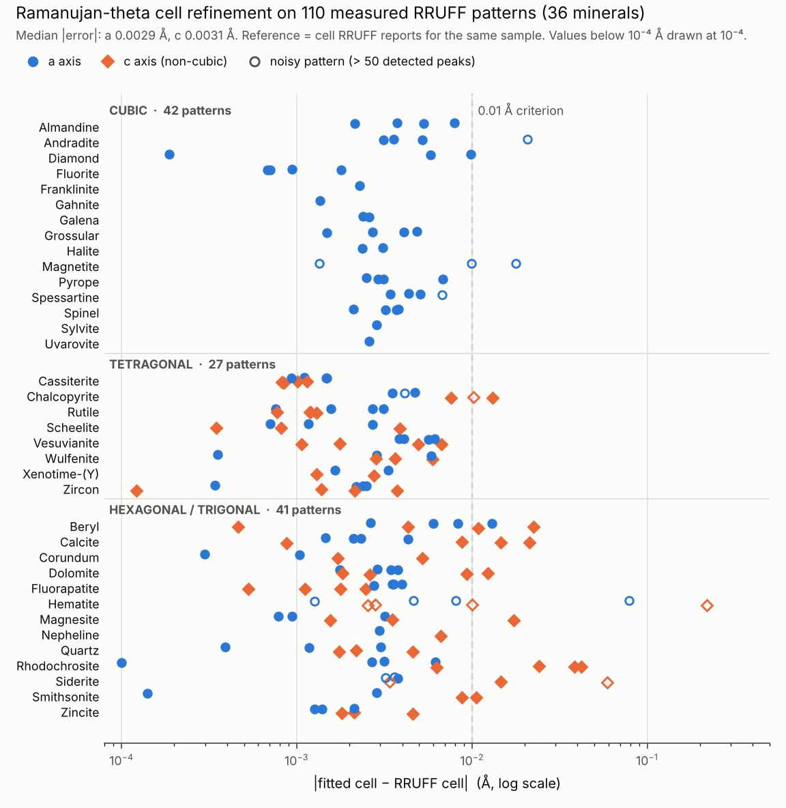

# 🔬 Spectral Identifier

**Identify minerals from real Raman and X-ray measurements, using Ramanujan theta functions, with a fit that tells you when not to trust it.**

OSI Hackathon 2026 · Team: Wilmer Gaspar Espinoza (Honduras), Adewunmi Olaniyi (Nigeria), Eugenio Bustamante (Ireland)



## What it does

1. **Raman identification:** cosine similarity against real RRUFF spectra (the query sample is never in the library) gives the mineral family.
2. **X-ray cell fit with Ramanujan theta functions:** every allowed diffraction line comes from a theta series: φ(q)³ for cubic crystals (h² + k² + l²), φ(q)² · φ(q) for tetragonal, Borwein's cubic theta a(q) · φ(q) for hexagonal/trigonal. The cell (a, c) and a zero shift are fitted to the measured peaks (`src/theta_xrd/`).
3. **Reliability flags:** noise level, share of the 10 tallest peaks explained, a chance-corrected match score and the uncertainty of a and c (`src/theta_xrd/quality.py`).
4. **AI literature layer:** Valency MCP Bond, searched by meaning and by exact words; a paper is cited only if it names the mineral (`src/ai/literature.py`).
5. **Demo app (marimo):** all of the above, live (`app/`).

## Results on real RRUFF data

Success criteria fixed before running: median cell error < 0.01 Å and ≥ 70 % of measured peaks explained.

| Test | Result | Script |
| --- | --- | --- |
| Raman identification, 120 spectra, 40 minerals | Top-1 93.3 %, top-5 100 % | `benchmarks/benchmark_real.py` |
| Raman 70/30 mixtures built from real spectra, 100 cases | Both mineral groups in top-2: 86 %; unknown phase ROC AUC 0.72 | `benchmarks/benchmark_real.py` |
| XRD cubic, 42 patterns, 15 minerals | Median error 0.0031 Å; 40/42 within 0.01 Å; 78 % of peaks explained | `benchmarks/validate_xrd_real.py` |
| XRD tetragonal + hexagonal, 68 patterns, 21 minerals | Median error a 0.0027 Å, c 0.0031 Å; both within 0.01 Å in 76 %; 87 % of peaks explained | `benchmarks/validate_xrd_real_uniaxial.py` |
| Reliability flags | 1 of 68 non-cubic fits flagged unreliable (hematite R060190, the one large failure), no false alarms; cubic: 1 of 2 large errors caught, 2 false alarms | same scripts |
| Theta series vs brute-force (h, k, l) counting | Identical for P, I, F cubic, N ≤ 200 | `benchmarks/validate_theta_xrd.py` |

A review found a bug (peaks matched to lines before the zero shift was applied). Fixing it turned vesuvianite from 4/4 failures into 4/4 fits within 0.007 Å. The pre-registered run also met the criteria and is kept in `benchmarks/output/validate_xrd_real_uniaxial_before_fix.txt`.

## Reproduce

```bash
pip install -r requirements.txt
python benchmarks/benchmark_real.py               # Raman identification and mixtures
python benchmarks/validate_xrd_real.py            # cubic X-ray patterns
python benchmarks/validate_xrd_real_uniaxial.py   # tetragonal / hexagonal X-ray patterns
python benchmarks/figure_xrd_all.py               # the figure above
marimo run app/app.py                             # demo app (http://localhost:2718)
```

The data subsets are committed (`data/rruff_subset/`, `data/rruff_xrd_subset/`); to rebuild them from RRUFF, see [`util/readme.md`](util/readme.md). Literature search: `export VALENCY_TOKEN=...`, then `python -m src.ai.literature Zircon --topic xrd` (never commit the token).

Demo app tabs:

- **X-ray · Ramanujan theta**: pick any of the 111 RRUFF powder patterns; toggle the Ramanujan-theta lines; fitted a (and c), error vs RRUFF, reliability flags, closest garnet end-member.
- **Raman · identification**: pick a RRUFF sample; top-5 minerals by cosine similarity (leave-one-sample-out).
- **Literature · Valency**: live search with `VALENCY_TOKEN`, otherwise the saved run.

## Honest limits

- Tetragonal and hexagonal cells are refined within ±3 % of the RRUFF cell (refinement, not indexing from scratch); cubic cells need no prior.
- Lattice theta series are classical (Wang & Torquato, [Phys. Rev. Research 2024](https://arxiv.org/abs/2502.02819)). Our contribution is using Ramanujan's φ, ψ and Borwein's a(q) as an exact line generator inside an AI pipeline validated on measured data.
- Space-group absences are applied for cubic minerals only; X-ray mixtures and the X-ray unknown-phase test are still simulated.
- Claude (Anthropic) was used as a coding assistant.

---

## Earlier prototype: Spectral Identifier v1 (before the hackathon)

The sections below describe the earlier v1 / GTSF prototype (Raman and FTIR descriptors). It is kept for reference; the validated hackathon results are the ones above.

**Theta-Ramanujan Spectral Analysis Engine for Raman and FTIR material identification**

Spectral Identifier v1 is an open-source research prototype for identifying and comparing scientific spectra using classical spectral processing combined with Theta-Ramanujan inspired mathematical descriptors.

That version focused on Raman and FTIR spectral analysis, material matching, anomaly detection, and scientific report generation.

---

## Project Status

This repository is an early-stage research prototype.

It is not a fully validated commercial or laboratory-certified system. The goal is to explore whether mathematical descriptors based on Theta-Ramanujan representations can support spectral identification, comparison, anomaly detection, and future AI-assisted materials analysis.

---

## Current Architecture

```text
Spectral Data Sources
        ↓
Preprocessing Engine
        ↓
Theta-Ramanujan Engine
        ↓
Peak Extraction
        ↓
Similarity and Matching
        ↓
Anomaly Detection
        ↓
Scientific Report
```

---

## GTSF v2 Development Branch

This branch introduces the first lightweight step toward the **Geometric Theta Spectral Framework (GTSF)**.

GTSF expands the original spectral identifier into a modular mathematical framework where spectra are not only compared by peaks, but transformed into interpretable mathematical descriptors.

The long-term idea is to study spectra as mathematical objects with geometric, statistical, and structural properties.

---

## Minimal GTSF Core

The file:

```text
src/gtsf_minimal.py
```

adds a lightweight descriptor prototype that computes:

- spectral entropy
- arc length
- roughness index
- curvature-like energy
- theta-inspired statistical moments

The current GTSF minimal core follows this simple flow:

```text
Raw spectrum
        ↓
Normalization
        ↓
Mathematical descriptor extraction
        ↓
GTSF descriptor dictionary
```

This is not a full Jacobi theta implementation yet. It is a safe and lightweight foundation for future development.

---

## Scientific Caution

This project generates mathematical descriptors from spectral data.

It does not claim to discover new physical properties by itself. Any physical interpretation must be validated with real spectral databases, experimental references, and comparison against classical spectral analysis methods.

The current objective is to build a reproducible research foundation, not to claim complete experimental validation.

---

## Supported Spectral Inputs

The project is designed for spectral data such as:

- Raman spectra
- FTIR spectra
- text-based spectral files
- CSV spectral data
- JSON spectral input

Future versions may expand toward:

- XRD
- LIBS
- UV-Vis
- additional scientific spectra

---

## API Endpoints

| Endpoint | Method | Description |
|----------|--------|-------------|
| `/` | GET | Web interface |
| `/api/health` | GET | System health check |
| `/api/identify` | POST | Identify a spectrum from file input |
| `/api/identify/json` | POST | Identify a spectrum from JSON input |
| `/api/database` | GET | List loaded reference materials |
| `/api/database/add` | POST | Add a reference material |
| `/api/compare` | POST | Compare two spectra directly |

---

## Theta-Ramanujan Engine

The current mathematical engine is based on Theta-Ramanujan inspired spectral transformations.

Implemented or planned components include:

- **q-map**: modular parameter mapping
- **phi descriptor**: spectral signature representation
- **psi descriptor**: multiscale spectral analysis
- **theta-inspired moments**: early interpretable descriptors
- **spectral complexity measures**
- **entropy-based descriptors**

---

## GTSF Research Direction

The Geometric Theta Spectral Framework aims to evolve the project into a multilayer mathematical architecture:

```text
Layer 1: Preprocessing
Layer 2: Theta-Ramanujan Representation
Layer 3: Spectral Manifold Construction
Layer 4: Differential Geometry Engine
Layer 5: Structural Descriptor Engine
Layer 6: Decision and AI Engine
```

The objective is to create interpretable descriptors that can support:

- material identification
- spectral comparison
- anomaly detection
- clustering
- ranking
- unknown material detection
- AI-ready scientific features

---

## Quick Start

```bash
git clone https://github.com/WilmerGaspar/spectral-identifier-v1.git
cd spectral-identifier-v1
pip install -r requirements.txt
python run.py
```

Then open:

```text
http://localhost:5000
```

---

## Run the Minimal GTSF Descriptor Demo

```bash
python src/gtsf_minimal.py
```

This runs a tiny demo spectrum and prints the generated mathematical descriptors.

---

## Repository Structure

```text
spectral-identifier-v1/
│
├── frontend/
│   └── templates/
│
├── src/
│   ├── anomaly/
│   ├── engines/
│   ├── matching/
│   ├── preprocessing/
│   ├── reporting/
│   ├── api.py
│   ├── data_loader.py
│   ├── pipeline.py
│   └── gtsf_minimal.py
│
├── requirements.txt
├── run.py
├── Procfile
└── README.md
```

---

## Deployment

### Render

Build command:

```bash
pip install -r requirements.txt
```

Start command:

```bash
gunicorn src.api:app
```

### PythonAnywhere

Upload the project files, configure the Flask WSGI entry point, and reload the app.

---

## Roadmap

### v0.1

- Basic Raman/FTIR spectral identifier
- API endpoints
- Web interface
- Reference database support
- Similarity and matching engine

### v0.2

- Minimal GTSF descriptor module
- Entropy descriptor
- Arc length descriptor
- Roughness descriptor
- Curvature-like energy descriptor
- Theta-inspired moments

### v0.3

- Add sample Raman/FTIR datasets
- Add reproducible notebooks
- Compare GTSF descriptors with classical peak matching
- Add basic tests

### v1.0

- Full documentation
- Public demo dataset
- Improved validation
- Exportable scientific reports
- Zenodo release

### GTSF v2

- Real Theta-Ramanujan descriptor implementation
- Spectral manifold construction
- Differential geometry descriptors
- Clustering and anomaly detection
- AI-ready descriptor matrix
- Validation against public spectral databases

---

## Limitations

- This is an early research prototype.
- Current descriptors require validation with real spectral datasets.
- The minimal GTSF module is not a complete mathematical implementation of the full framework.
- Results should not be interpreted as certified laboratory identification.
- Physical meaning must be tested against known references and experimental data.

---

## Author

**Wilmer Gaspar Espinoza Castillo**

Research interests:

- materials informatics
- spectroscopy
- mathematical descriptors
- Theta-Ramanujan representations
- scientific AI
- spectral analysis
- open research tools

---

## License

License to be defined.

---

## Citation

A formal citation will be added after the first stable release and Zenodo DOI.
